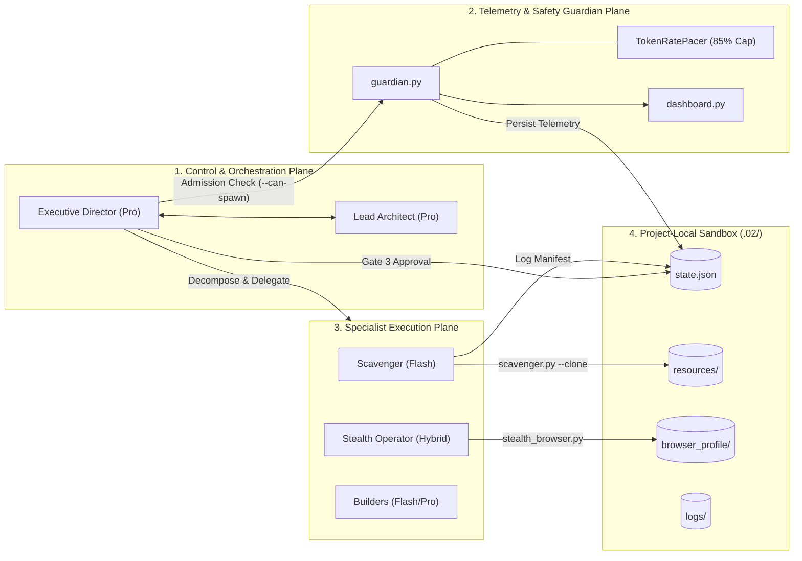
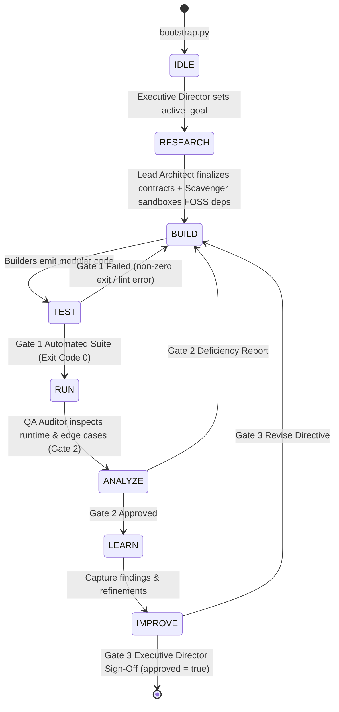
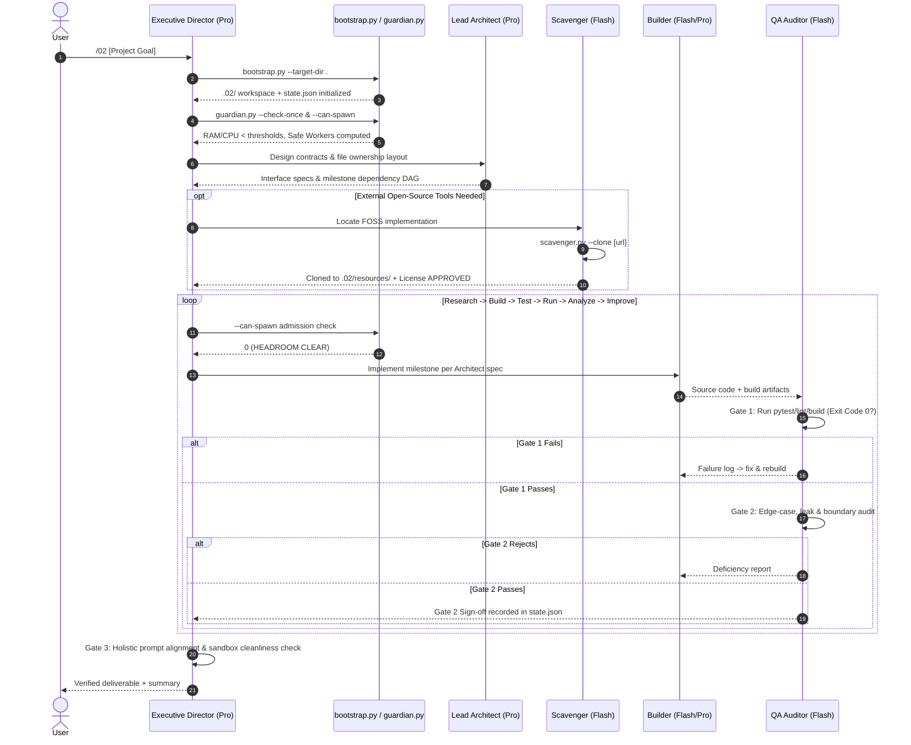

# 02 Architecture Deep Dive

This document provides the complete technical architecture of the **`02`** Autonomous Multi-Agent Production Team Engine—covering its four-plane design, hierarchical agent roster, model routing strategy, hardware protection math, predictive rate-limiting algorithm, sandboxed resource harvesting, stealth automation mechanics, and the Triple-Gate Verification state machine.

---

## 1. Design Philosophy & Problem Statement

Single-agent coding workflows frequently break down on multi-file, research-heavy, or long-running tasks due to four failure modes:

1. **Unchecked Context & Role Drift** — One model context simultaneously acts as planner, dependency hunter, coder, and test reviewer, causing it to skip edge cases and rubber-stamp its own output.
2. **Host Resource Exhaustion** — Spawning concurrent builds, headless browsers, and local ML jobs blindly can push RAM and CPU above `90%`, causing OS stuttering, OOM crashes, or thermal locks.
3. **API Rate Limit Lockouts (HTTP 429)** — Bursty parallel subagent calls saturate Requests Per Minute (RPM) and Tokens Per Minute (TPM) quotas, stalling the pipeline.
4. **Workspace Pollution & Unaudited Code** — Downloading external repositories directly into the project tree introduces licensing conflicts, dead code, and untracked binaries.

**`02`** solves these by separating responsibilities into **four orthogonal architectural planes** backed by a persistent project-local state file (`.02/state.json`).

---

## 2. Four-Plane Architectural Topology

### Plane Breakdown

| Plane | Components | Responsibility |
| :--- | :--- | :--- |
| **1. Control & Orchestration** | Executive Director, Lead Architect | Goal decomposition, interface contracts, file layout ownership, budget governance, and final Gate 3 approval. |
| **2. Telemetry & Safety Guardian** | `guardian.py`, `dashboard.py`, `TokenRatePacer` | Real-time RAM/CPU/GPU sampling, concurrency admission checks, sliding-window RPM/TPM enforcement, and CLI observability. |
| **3. Specialist Execution** | Scavenger, Stealth Operator, Builders, QA Auditor | Isolated research, license auditing, web interaction, modular implementation, and empirical test verification (Gates 1 & 2). |
| **4. Project-Local Sandbox** | `<project_root>/.02/` | Self-contained persistence for `state.json`, `resources/`, `browser_profile/`, `logs/`, and `.gitignore`. |

---

## 3. Hierarchical Roster & Tiered Model Routing

`02` separates **strategic reasoning** from **high-throughput execution** to preserve reasoning quality while minimizing latency and token spend:

| Roster Key (`state.json`) | Role | Model Tier | Core Authority & Toolset |
| :--- | :--- | :--- | :--- |
| `director` | **Executive Director** | `pro` (Deep Reasoning) | Milestone decomposition, rate governance, Gate 3 holistic sign-off. |
| `lead_architect` | **Lead Architect** | `pro` (Deep Reasoning) | System boundaries, schemas, file ownership map to prevent parallel write conflicts. |
| `scavenger` | **Scavenger & Researcher** | `flash` (High Speed) | Web/GitHub discovery, license verification, sandboxed cloning via `scavenger.py`. |
| `stealth_operator` | **Stealth Web Specialist** | `hybrid` (`flash` + Playwright) | Persistent browser workflows via `stealth_browser.py`. |
| `builder` | **Builder / Engineers** | `flash` / `pro` | Implementing architect specs, integrating `.02/resources/`, running linters. |
| `qa_auditor` | **QA Auditor & Test Engineer** | `flash` (Skeptical Evaluator) | Authoring unit/integration tests, executing Gate 1, auditing Gate 2 boundaries. |

### Why Tiered Routing Matters

- **Cost & Quota Efficiency:** High-volume tasks (scanning files, parsing logs, writing unit tests, running linters) run on `flash` / `flash-lite`, preserving `pro` quota for architectural synthesis and root-cause debugging.
- **Role Separation (No Self-Grading):** Builders write implementation against Lead Architect contracts; the QA Auditor operates with an explicitly adversarial persona (`references/roles.md`) to challenge boundary conditions before the Executive Director reviews Gate 3.

---

## 4. Autonomous Lifecycle & Triple-Gate State Machine

Every objective runs inside a closed iterative loop:

$$\text{Research} \longrightarrow \text{Build} \longrightarrow \text{Test} \longrightarrow \text{Run} \longrightarrow \text{Analyze} \longrightarrow \text{Learn and Improve}$$

The active stage is tracked in `.02/state.json` under `active_stage` (`IDLE`, `RESEARCH`, `BUILD`, `TEST`, `RUN`, `ANALYZE`, `LEARN`, `IMPROVE`).

### Gate Transition Invariants

1. **Gate 1 (`gate_1_executable_tests`)** — Non-negotiable empirical check: compilation, linters, type checks, and unit/integration suites must execute in the terminal and exit with code `0`. Mocked pass assertions are disallowed.
2. **Gate 2 (`gate_2_qa_auditor_signoff`)** — Independent adversarial check: inspects null/empty/oversized inputs, error recovery, socket/file/subprocess cleanup, and code modularity. Emits `PASS` or a deficiency report returning execution to `BUILD`.
3. **Gate 3 (`gate_3_director_approval`)** — Holistic check against the original user prompt: confirms ergonomics, documentation completeness, clean temporary scratch state, and strict containment of third-party assets inside `.02/resources/`.

---

## 5. Hardware Protection Envelope & Concurrency Math

Implemented across `references/hardware_policy.md` and `scripts/guardian.py`, the Hardware Guardian enforces strict host stability while leaving GPU compute completely unrestricted:

### Resource Threshold Matrix

| Resource | Target Operating Zone | Throttle Trigger | Hard Ceiling | Behavior on Threshold |
| :--- | :--- | :--- | :--- | :--- |
| **System RAM** | $\le 85\%$ | `87.0%` (`RAM_THROTTLE_TRIGGER`) | `< 90.0%` (`RAM_HARD_CEILING`) | `check_spawn_headroom()` returns `False` (`exit 1`); `--daemon` logs warnings at `87%` and critical halts at `90%`. |
| **System CPU** | $\le 80\%$ | `85.0%` (`CPU_THROTTLE_TRIGGER`) | `< 90.0%` (`CPU_HARD_CEILING`) | Blocks spawning additional parallel workers; `--check-once` exits `2` (`ALERT`). |
| **NVIDIA GPU** | Up to `100%` | None | **Unlocked** | Full CUDA / Tensor Core utilization permitted (e.g., RTX 4050 local inference, Whisper, video encoding). |

### Dynamic Worker Pool Formula

When scaling concurrent subagents, compilers, or browser contexts, `references/hardware_policy.md` defines:

$$\text{Safe Workers} = \max\left(1, \min\left(4, \left\lfloor \frac{\text{Available RAM (GB)} - 2.0}{1.5} \right\rfloor \right)\right)$$

- **OS Reserve:** Always reserves at least `2.0 GB` for Windows background services and UI responsiveness.
- **Per-Worker Allocation:** Budgets `1.5 GB` per concurrent worker process, capped at `4` simultaneous workers.
- **Browser Cap:** Maximum `2` concurrent headless Playwright contexts.

### Telemetry Fallback Chain

`guardian.py` avoids single points of failure when measuring host metrics:
1. **Primary Path:** Uses `psutil.virtual_memory()` and `psutil.cpu_percent(interval=0.2)` for fast cross-platform telemetry.
2. **Windows CIM Fallback:** If `psutil` is absent, queries `Win32_OperatingSystem` and `Win32_Processor` via PowerShell `Get-CimInstance`, falling back to conservative safe assumptions (`50.0%` RAM, `20.0%` CPU) if WMI queries fail.
3. **GPU Probe:** Queries `nvidia-smi --query-gpu=name,utilization.gpu,memory.used,memory.total,temperature.gpu` with a 3-second timeout and gracefully reports `available: false` on CPU-only machines.

---

## 6. Predictive Token Bucket Rate Pacing

`TokenRatePacer` inside `scripts/guardian.py` prevents burst-induced HTTP `429 Too Many Requests` failures using a **60-second sliding window** capped at `85%` (`API_RATE_SAFETY_MARGIN = 0.85`) of configured quotas:

- **Default Quotas:** `max_rpm = 1000`, `max_tpm = 1_000_000` (configurable per provider tier when instantiated in Python).
- **Safe Envelope:** `safe_rpm = int(max_rpm * 0.85)` (`850`) and `safe_tpm = int(max_tpm * 0.85)` (`850,000`).
- **Sliding Pruning:** Every `record_request(tokens_used)` and `current_velocity()` call prunes timestamps older than `now - 60.0` seconds.
- **Status Signal:** Emits `"CLEAR"` while `rpm < safe_rpm` and `tpm < safe_tpm`, switching immediately to `"THROTTLED"` before hitting provider hard caps so the Executive Director can inject jittered backoff.

---

## 7. Sandboxed Scavenger Pipeline

`scripts/scavenger.py` enforces two invariants on every external dependency or reference implementation:

1. **Zero-Cost Open-Source License Verification (`check_license_string`)**
   - Scans up to the first `2048` bytes of any `LICENSE*` file (or raw license text) against `FREE_LICENSES` (MIT, Apache 2.0, BSD-2/3, GPL 2/3, LGPL 2.1/3, AGPL 3, Unlicense, CC0, Public Domain, ISC, MPL 2.0).
   - Explicitly rejects proprietary, commercial-required, or paywalled strings (`REJECTED`).
   - Flags unrecognized licenses lacking standard permissive text as `FLAGGED_FOR_REVIEW` for human/Director inspection.
2. **Strict Project Sandboxing (`clone_or_download_repo`)**
   - Shallow-clones (`git clone --depth 1`) exclusively into `<project_root>/.02/resources/<repo_name>/`.
   - Never modifies the host project's main source folders or global package directories.
   - Records provenance (`name`, `url`, `local_path`, `license`, `status`) inside `.02/state.json -> scavenged_resources`.

---

## 8. Stealth Browser Automation Mechanics

`scripts/stealth_browser.py` implements defense-in-depth behavioral realism for web automation tasks that standard headless scripts fail on:

1. **Cubic Bézier Cursor Trajectories (`bezier_curve`, `generate_human_path`)**
   - Computes two randomized control points (`ctrl1`, `ctrl2`) offset by $\pm 40\text{ px}$ between start and destination coordinates:
     $$B(t) = (1-t)^3 P_0 + 3(1-t)^2 t P_1 + 3(1-t)t^2 P_2 + t^3 P_3, \quad t \in [0, 1]$$
   - Adds $\pm 1.5\text{ px}$ micro-tremor noise at each interpolation step to avoid linear bot kinematics.
2. **Keystroke Cadence (`human_type_delay`)**
   - Emits randomized inter-keystroke delays drawn uniformly from `50 ms` to `150 ms`.
3. **Automation Fingerprint Suppression (`run_stealth_fetch`)**
   - Passes `--disable-blink-features=AutomationControlled` and `--disable-infobars` to Chromium.
   - Injects an `add_init_script` shim redefining `navigator.webdriver` to `undefined`.
   - Uses a persistent Chromium user data directory at `<project_root>/.02/browser_profile/` so cookies, local storage, and session tokens persist cleanly across runs (and remain excluded from git via `.02/.gitignore`).
   - Falls back cleanly to `urllib.request` with desktop HTTP headers when Playwright is not installed.

---

## 9. Sequence Diagram: End-to-End Task Execution

---

## 10. Scope & Implementation Boundaries

To keep this architecture documentation accurate to the codebase:

- **Enforced Directly in Python Scripts:**
  - `.02/` directory scaffolding, gitignore creation, and initial `state.json` schema (`bootstrap.py`).
  - Live RAM/CPU/GPU polling, threshold detection (`87%`/`85%` throttle, `90%` hard cap), `Safe` exit-code admission gating (`--can-spawn`), `TokenRatePacer` sliding-window RPM/TPM calculation, and `state.json` telemetry persistence (`guardian.py`).
  - Real-time terminal dashboard rendering (`dashboard.py`).
  - Shallow-clone sandboxing into `.02/resources/` and keyword/regex FOSS license screening (`scavenger.py`).
  - Cubic Bézier mouse coordinate generation, keystroke jitter helper, persistent Chromium profile launch, and `navigator.webdriver` masking (`stealth_browser.py`).
- **Coordinated Cooperatively by Agent Instructions (`SKILL.md` & `references/*.md`):**
  - Model tier selection (`Pro` vs `Flash`), role persona prompts, `Safe Workers` concurrency throttling when `--can-spawn` returns `1`, and Gate 2 / Gate 3 sign-off transitions in `.02/state.json`. `guardian.py` provides the telemetry and admission signals rather than issuing OS-level process suspension (`SIGSTOP`) on its own.
