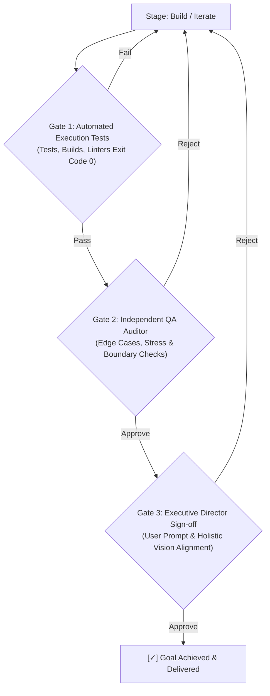

# 02 Triple-Gate Verification Protocol

The **`02`** Autonomous Production Team never terminates a loop based on self-congratulatory output. To declare any milestone or final goal complete, deliverables must pass three independent gates in sequence.

---

## Gate 1: Executable Automated Tests

**Responsible:** QA Auditor / Terminal Test Runner  
**Criteria:**
1. Code must compile or build without fatal errors.
2. All unit and integration tests must run and exit with code `0`.
3. Linters / type checkers must pass without unhandled errors.
4. No mocked "fake" tests—tests must exercise real execution paths.

**Checklist:**
- [ ] Build command succeeds (`npm run build`, `python -m py_compile`, etc.).
- [ ] Test harness passes (`pytest`, `jest`, etc.).
- [ ] Runtime execution of primary entrypoints tested in terminal.

---

## Gate 2: Independent QA Auditor Sign-Off

**Responsible:** QA Auditor (Evaluator Persona)  
**Criteria:**
1. Skeptical code audit: Are error states, network disconnects, or invalid inputs handled gracefully?
2. Boundary conditions: What happens if input is empty, null, massive, or malformed?
3. Memory and resource leak assessment: Are files, sockets, and subprocesses closed cleanly?
4. Documentation and maintainability: Is the code clean and well-structured?

**Decision:**
- **PASS:** QA Auditor issues an official sign-off ticket in `.02/state.json`.
- **FAIL:** QA Auditor provides a detailed deficiency report and sends the work back to the Builder.

---

## Gate 3: Executive Director Holistic Sign-Off

**Responsible:** Executive Director  
**Criteria:**
1. Original Prompt Fidelity: Does the deliverable fulfill everything the user originally asked for?
2. User Experience & Ergonomics: Is it easy to use? Are the commands intuitive?
3. Overall Polish: Are all temporary scratch files cleaned up? Are scavenged assets safely sandboxed in `.02/resources/`?

**Decision:**
- **APPROVED:** The Director records task completion in `.02/state.json`, terminates the autonomous loop, and presents the completed work to the user.
- **REVISE:** The Director provides clear corrective instructions and re-engages the team.
